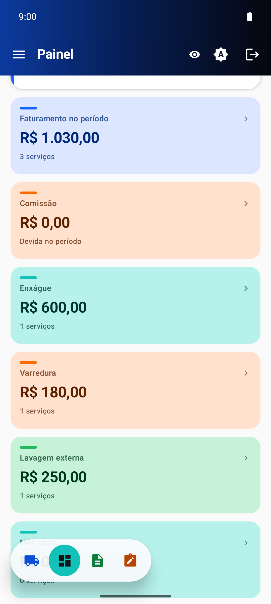
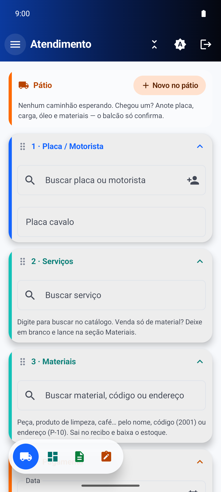
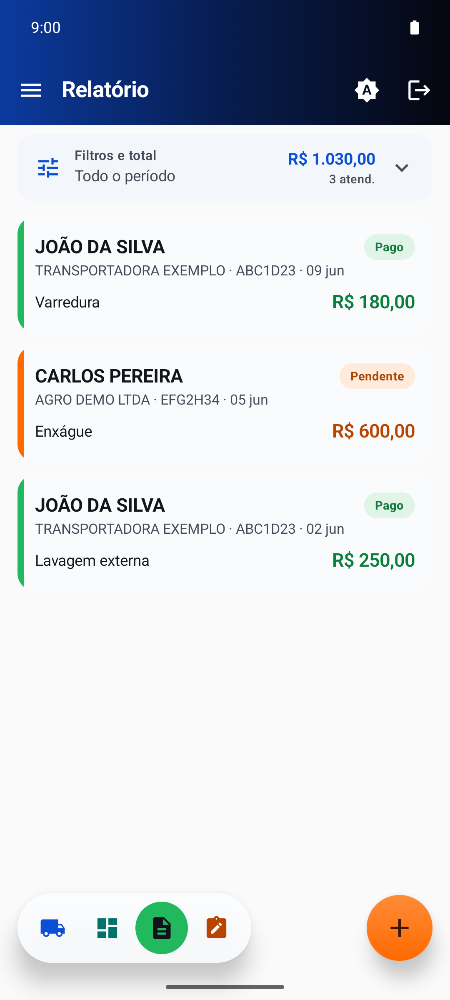
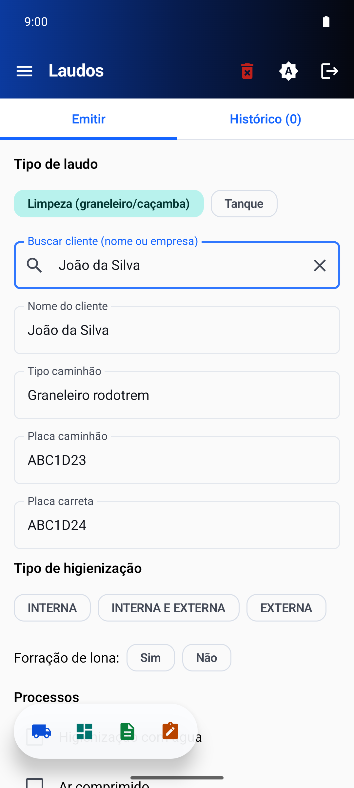
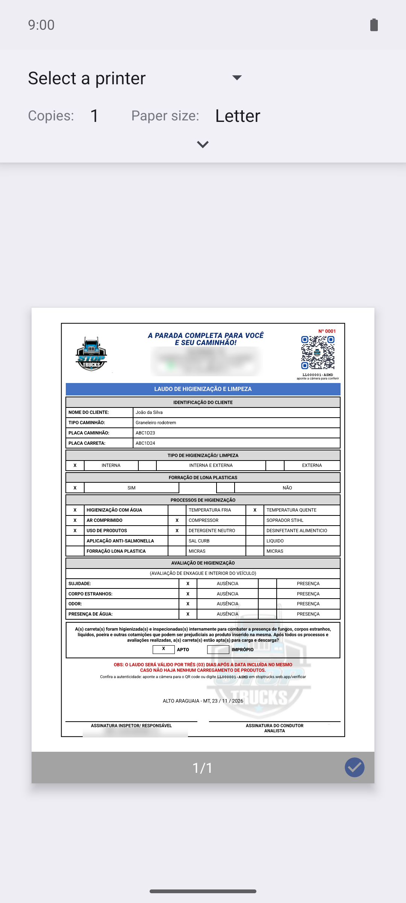
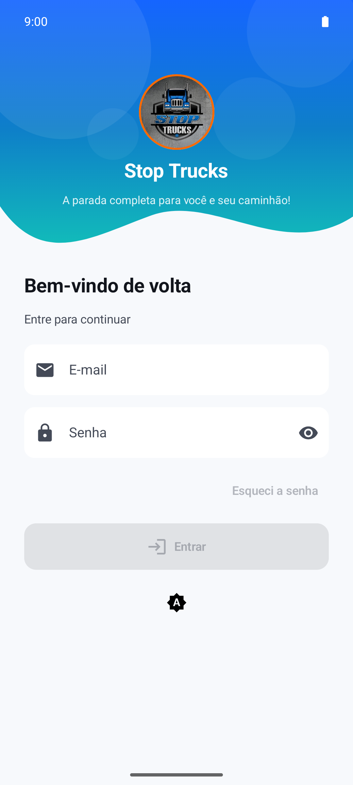

# Stop Trucks Higienizador

Sistema de gestão de um higienizador de caminhões-tanque em Alto Araguaia (MT), às margens da BR-364. Substituiu a planilha da operação. Criado e mantido por mim, com desenvolvimento assistido por IA.

🌐 Site: [stoptruckshigienizador.com](https://stoptruckshigienizador.com)

> O código-fonte é privado porque contém dados reais do cliente. Este repositório apresenta o projeto.

## O que o sistema faz
- Ordens de serviço de lavagem e higienização, compartimento por compartimento.
- Laudo de higienização com QR Code, conferido numa página pública.
- Motor de ponto pela CLT: lê o arquivo AFD do relógio de ponto e gera o recibo de quitação com horas extras.
- Migração de cerca de 14,6 mil registros da planilha original.

## Números
- Kotlin Multiplatform com 4 alvos: Android, iOS, Web (Kotlin/Wasm) e Desktop.
- 87% do código compartilhado.
- Cerca de 320 testes automatizados.
- Versão em KMP: 254 commits (jun a nov/2026), autor único. O sistema é de antes; em 2026 foi reescrito em Kotlin Multiplatform.

## Stack
Kotlin Multiplatform · Compose Multiplatform · Koin · Firebase (Auth, Firestore, Storage, Hosting) · Cloud Functions (Python) · IA com especificação (SDD e PRD)

## Telas (Android, dados de demonstração)

     

---
**English:** Management system for a tank-truck cleaning business in Brazil. Kotlin Multiplatform (Android, iOS, Web, Desktop), 87% shared code, ~320 tests, web version in production. Built solo with AI-assisted development.
